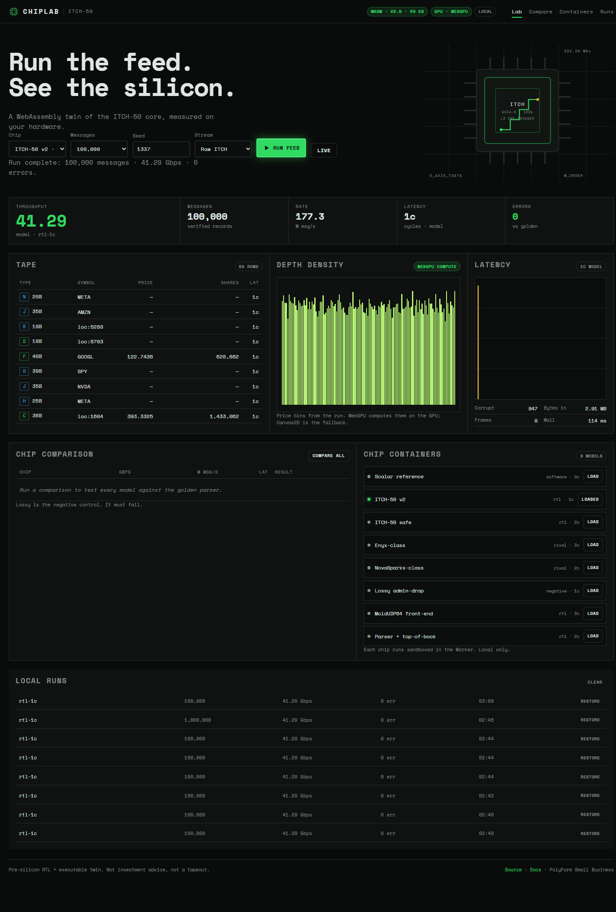
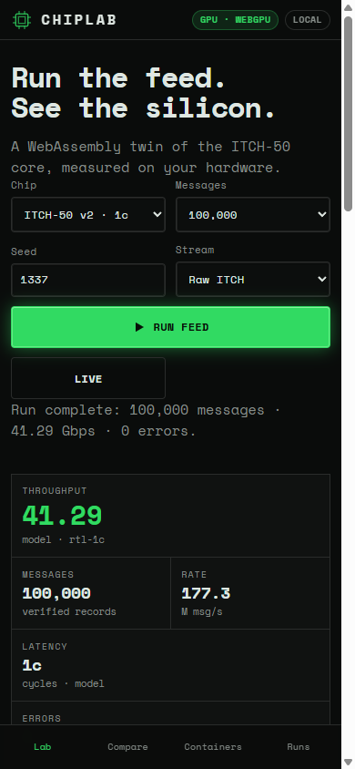

<!--
JSON-LD for search engines and AI indexers
{
  "@context": "https://schema.org",
  "@type": "SoftwareSourceCode",
  "name": "ChipLab — ITCH-50 silicon lab",
  "description": "Local-first WebAssembly + WebGPU lab for a NASDAQ ITCH 5.0 parser, with RTL, formal proofs, a Node backend, MCP, npm/PyPI packages, a single EXE, Docker and Vercel.",
  "programmingLanguage": ["SystemVerilog", "Rust", "JavaScript", "Python"],
  "author": { "@type": "Person", "name": "timfromhcs", "email": "timfromhcs@gmail.com", "url": "https://github.com/timfromhcs" },
  "license": "https://github.com/timfromhcs/ultra-low-latency-nasdaq-itch50-core/blob/main/LICENSE.md",
  "keywords": ["systemverilog","verilog","hft","high-frequency-trading","nasdaq-itch","itch50","market-data","low-latency","fpga","asic","webassembly","webgpu","rust","mcp","formal-verification","openlane","sky130","orderbook"]
}
-->

# ChipLab — ITCH-50 silicon lab

[](.github/workflows/ci.yml)
[](rtl/)
[](web/wasm/chiplab_core.wasm)
[](web/gpu.js)
[](reports/formal.json)
[](#honest-limits)

**Run the feed. See the silicon.** A WebAssembly twin of a NASDAQ TotalView-ITCH 5.0
parser, measured on your own hardware, with a WebGPU order-book visualisation and a
single-file local backend. Pre-silicon, reproducible, and honest about what is not proven.

**[Live demo](https://chiplab-ten.vercel.app/)** · **[Local demo](http://127.0.0.1:4173)** after `node backend/server.mjs`.



---

## What this is

- An **RTL ITCH 5.0 parser** (`rtl/`) that decodes all 22 official opcodes, preserves
  reference data, handles `tkeep`/`tlast`, and ships 128/256/512-bit variants.
- A **MoldUDP64 front-end** (`moldudp64_frontend.sv` + `depacketizer.sv`) with IP/UDP
  filtering, sequence-gap detection and **back-to-back multi-frame** flow control.
- A **field-accurate reference model** in Python (`tb/itch_model.py`) and Rust
  (`wasm-core/`), cross-checked record-by-record.
- A **local-first web app**: WASM in a Worker, WebGPU compute for price bins and
  latency histograms, Canvas2D fallback, OPFS persistence, PWA/offline.
- A **Node backend / MCP server / REST API / npm package / PyPI package / single EXE /
  Docker image / Vercel build** around the same WASM core.
- A **native Vulkan/DX12 compute runner** (`native/`) using `wgpu`, with an opt-in
  Windows process boost.
- **Verification evidence**: 1,000,000-message full-field regression, Z3 formal (BMC,
  k-induction, covers), CVC5 recorded pass (2026-11-03; see the formal note),
  proofs, synthesis matrix, mutation tests, browser gates.

## What this is not

- **Not silicon-proven.** There is no tapeout. Fmax is not signed off.
- **Not a trading system.** No order routing, no live feed, no investment advice.
- **Not a zero-cycle wire-to-output parser.** The honest latency is:
  one clock from `s_axis_tdata` into the window register + one clock to the registered
  output = **2 clocks (6.20 ns at 322.26 MHz)**. The async bypass is valid in the same
  cycle as the window, one clock after ingress.
- **MoldUDP64 is verified in simulation, not on a 100G MAC.** Back-to-back frames
  (including a sequence gap and a dropped-port frame) pass end to end; the Ethernet
  ingress itself is modelled in the testbench.

---

## Stable release: v0.3.1 "Local Cloud"

v0.3.1 (patch of v0.3.0) is the first release meant to be installed and used without a developer.
It ships **local cloud + web + EXE + GitHub Releases**, with honest limits.

| Piece | What you get |
|---|---|
| **Local cloud** | LAN service on your machine, local JSON persistence under `.data/`, optional bearer token, no cloud account |
| **Web** | Same PWA at `localhost`, on a phone over LAN, and on Vercel; WebGPU with Canvas2D fallback |
| **EXE** | `dist\chiplab.exe` starts the local cloud + web UI from one file |
| **GitHub** | Tag-driven release with EXE, npm tarball, Python wheel/sdist, SBOM and SHA-256 checksums |
| **MCP** | 12 read-only tools for agents, strict schemas, hashed audit log |
| **Design** | Reviewed copy, mobile 390 px and desktop 1440 px layouts |

### Local cloud quickstart

```bash
# loopback only (default): writes allowed from this machine
node backend/server.mjs

# LAN: phone/tablet on the same network, token required for remote writes
node backend/server.mjs --host 0.0.0.0 --token "choose-a-long-token"

# or use the single EXE
dist\chiplab.exe --host 0.0.0.0 --port 4173 --token "choose-a-long-token"
```

Open the LAN URL printed on startup in the **Local cloud** panel of the web app,
enter the token if you set one, then press **Test** → **Sync** / **Pull**.

### Local cloud API

| Endpoint | Method | Auth | Purpose |
|---|---|---|---|
| `/api/cloud/info` | GET | none | version, LAN URLs, token state, data dir, uptime, namespaces |
| `/api/store` | GET | token if set, else loopback | list namespaces |
| `/api/store/:namespace` | GET | same | read `{revision, updatedAt, data}` |
| `/api/store/:namespace` | PUT | same | write `{data, expectedRevision}`; 409 on conflict, 413 over 1 MB |
| `/api/store/:namespace` | DELETE | same | delete one namespace |

Namespaces are `[A-Za-z0-9_-]{1,32}`. Files are written atomically (temp + rename),
mode `0o600`, and capped at 1 MB. There is no directory browsing.

### Local cloud security model

- Loopback by default; `--host 0.0.0.0` is an explicit opt-in.
- With `--token`, **all** store operations require `Authorization: Bearer <token>`.
  Without a token, only loopback clients may read or write.
- Data lives only in `.data/` on your machine (git-ignored); the Vercel deployment has
  no database and never receives it.
- The EXE is **not code-signed**; verify the published SHA-256 before running it.

### Versioning and releases

- Semantic Versioning; contents of a published version never change.
- `CHANGELOG.md` follows Keep a Changelog and is the source of release notes.
- `.github/workflows/release.yml` runs on tag `v*`: verify → Windows EXE → npm/Python
  packages → SBOM → `SHA256SUMS.txt` → GitHub Release.
- **v1.0.0 is deliberately not claimed.** It is reserved for multi-frame MoldUDP64
  back-pressure, RTL top-of-book, LibreLane/OpenSTA timing/DRC/LVS sign-off and
  published artifacts with provenance.

Release artifacts:

| Artifact | Produced by |
|---|---|
| `chiplab.exe` | `npm run build:exe` (Node SEA, unsigned) |
| `chiplab-core-0.3.1.tgz` | `cd packages/npm && npm pack` |
| `chiplab_itch-0.3.1-py3-none-any.whl` + `.tar.gz` | `cd packages/python && python -m build` |
| `sbom.json` | `node scripts/sbom.mjs` |
| `SHA256SUMS.txt` | `node scripts/checksums.mjs dist/release` |

Verify a download with `sha256sum -c SHA256SUMS.txt` (or `Get-FileHash` on Windows).
Every release EXE, npm tarball and Python wheel/sdist also carries a **SLSA build
provenance** attestation from GitHub Actions:

```bash
gh attestation verify chiplab.exe --repo timfromhcs/ultra-low-latency-nasdaq-itch50-core
gh attestation verify chiplab-core-0.3.1.tgz --repo timfromhcs/ultra-low-latency-nasdaq-itch50-core
```

The container image publishes `provenance: mode=max`, an SBOM attestation and a
**keyless cosign signature**. Inspect the attestation manifest with
`docker buildx imagetools inspect ghcr.io/timfromhcs/ultra-low-latency-nasdaq-itch50-core:main`
and verify the signature (using the image digest from that output):

```bash
cosign verify ghcr.io/timfromhcs/ultra-low-latency-nasdaq-itch50-core@sha256:<digest> \
  --certificate-identity-regexp 'https://github.com/timfromhcs/.*' \
  --certificate-oidc-issuer https://token.actions.githubusercontent.com
```

The npm tarball, Python wheel and sdist are signed as blobs (`*.sigstore.json` bundles
attached to the release). Verify one with:

```bash
cosign verify-blob --bundle chiplab-core-0.3.1.tgz.sigstore.json \
  --certificate-identity-regexp 'https://github.com/timfromhcs/.*' \
  --certificate-oidc-issuer https://token.actions.githubusercontent.com \
  chiplab-core-0.3.1.tgz
```

The first published release is
[v0.3.1](https://github.com/timfromhcs/ultra-low-latency-nasdaq-itch50-core/releases/tag/v0.3.1) (first: [v0.3.0](https://github.com/timfromhcs/ultra-low-latency-nasdaq-itch50-core/releases/tag/v0.3.0))
with `chiplab.exe`, the npm tarball, the Python wheel/sdist, `sbom.json` and
`SHA256SUMS.txt`. Reproducibility status: the WASM (`make repro-wasm`, pinned rustc
1.98.1), the Python wheel/sdist (`make repro-python`, `SOURCE_DATE_EPOCH` + normalized
sdist) and the Windows EXE (`node scripts/repro_exe.mjs`, same Node 22 toolchain)
rebuild byte-identically. The weekly `Repro` workflow checks all three.

Registry publishing is opt-in and off by default: set the repository variable
`NPM_PUBLISH=true` (npm trusted publishing or token) or `PYPI_PUBLISH=true` (PyPI
trusted publishing) before pushing a tag. Without them the Release workflow only
produces the GitHub Release assets. The publish steps are prepared but have not been
run against the registries.

---

## Quickstart

```bash
git clone https://github.com/timfromhcs/ultra-low-latency-nasdaq-itch50-core.git
cd ultra-low-latency-nasdaq-itch50-core

# 1) Web demo + local API (Node 22, no npm dependencies)
node backend/server.mjs
# open http://127.0.0.1:4173
```

The web app also works as a static PWA. The browser keeps its own run history in OPFS;
nothing is uploaded.

### Choose your runtime

| Runtime | Command | What you get |
|---|---|---|
| Web + API | `node backend/server.mjs` | WebGPU/WASM demo, `/api/*` |
| Local cloud | `node backend/server.mjs --host 0.0.0.0 --token …` | LAN service + local JSON store |
| CLI | `node backend/run.mjs --compare --count 1000000` | 8-chip comparison |
| Single EXE | `npm run build:exe && dist\chiplab.exe` | one file, embedded web + WASM + local cloud |
| Docker | `docker compose up --build` | same demo at `localhost:4173` |
| Vercel | `npx vercel` (or MCP) | static app + stateless `/api/*` |
| MCP | `node mcp/server.mjs` | 12 read-only tools for agents |
| npm | `npm i @chiplab/core` | WASM core + CLI |
| PyPI | `pip install chiplab-itch` | Python reference model + CLI |

### Verification

```bash
# Linux/WSL toolchain: verilator, yosys, iverilog, z3, cvc5, python cocotb/pytest
make lint                # Verilator, 0 warnings
python tb/itch_model.py --count 100000 --out tb/vectors
make sim                 # full-field Verilator regression
make formal              # Z3 BMC + k-induction + covers
./formal/solver_matrix.sh
python -m pytest -q tb/test_model.py
node scripts/wasm_smoke.mjs && python scripts/check_wasm_fixture.py
node backend/run.mjs --compare --count 1000000
node mcp/client_smoke.mjs
node scripts/test_cloud_api.mjs
node scripts/release_check.mjs
node scripts/build_vercel.mjs && node scripts/test_vercel_api.mjs
```

---

## Measured evidence

All numbers below are **model/simulation results at 322.26 MHz**, not silicon.
Reports live in [`reports/`](reports/).

| Check | Result | Evidence |
|---|---|---|
| Full-field RTL regression | **1,000,000 / 1,000,000 records, 0 mismatches**, 31,383,973 bytes, 1,961,516 cycles, 41.290 Gbps | `reports/sim_1m.txt` |
| Fields checked | type, flags, length, locate, tracking, timestamp, ref, new-ref, shares (64b), stock, price, match, MPID, printable, event, payload checksum | `tb/sim_main.cpp` |
| Reference model | independent Python, all 22 opcodes | `tb/itch_model.py` |
| WASM ↔ Python | 10,000 records, 0 mismatches | `scripts/check_wasm_fixture.py` |
| RTL ↔ WASM | **100,000 records on one stream, every canonical field equal** | `scripts/rtl_wasm_equiv.mjs` |
| Formal | **Z3 PASS** (BMC + k-induction + covers); CVC5 1.3.2 re-run: BMC + k-induction PASS at depth 8, covers not completed (needs depth 20; slow on this host). The committed CVC5 pass is from 2026-11-03 | `reports/formal.json`, `reports/formal_cvc5.log` |
| Mutation | **10/10 RTL mutants killed** (length, offsets, share width, flags, append, consume) | `reports/mutation.json` |
| Mutation (BBO) | **9/9 parser→BBO mutants killed** (side, hash slot, cancel, max/min, volume, last) | `reports/mutation_book.json` |
| Synthesis 128-bit | 22,710 cells, 2,228 DFFs | `reports/synth_128.log` |
| Synthesis 256-bit | 25,324 cells | `reports/synth_256.log` |
| Synthesis 512-bit | 29,568 cells | `reports/synth_512.log` |
| Native Vulkan (Radeon 680M) | 200,000 records in **46.49 ms** (re-run 2026-11-10), bins vs CPU **0 mismatches**, checksum 254251 | `reports/native_bins.bin` |
| Local cloud | token required for non-loopback writes, revision conflict → 409, traversal → 400 | `backend/store.mjs` |
| AXI4-Stream skid | 200 random beats under random `tready`, **no loss** | `tb/test_skid.py` |
| MoldUDP64 multi-frame | **5 frames back-to-back, 28 records, 1 gap, 1 drop**, no loss | `tb/test_mold_multi.py` |
| Mold back-pressure | **329 bytes under random `m_axis_tready`, no loss or reordering** | `tb/test_mold_pipeline.py` |
| Sequence recovery | **gap request, replay recovery, timeout abandon, duplicates** | `tb/test_recovery.py` |
| RTL top-of-book | **400 random events + 100 back-to-back (1 event/cycle, no stall)**, 0 mismatches; top-4 depth; risk limits | `tb/test_book.py` |
| LibreLane toolchain | **3.0.17 smoke test: Classic 80/80, DRC ✅, LVS ✅**; full P&R blocked by ~1,100-pin congestion (no sign-off) | `openlane/README.md` |
| Sky130 pre-PnR STA | **250 MHz WNS −8.27 ns · 322 MHz WNS −9.14 ns · Fmax ≈ 81.5 MHz**; worst path FF → `raw_payload[0]` (ss, pre-PnR, no sign-off) | `reports/openlane_sky130-250mhz-sta.json` |
| GF180 pre-PnR STA | **322 MHz WNS −19.87 ns · Fmax ≈ 43.5 MHz**; worst path FF → `raw_order_data[260]` (ss/125 °C, pre-PnR) | `reports/openlane_gf180-sta.json` |
| IHP SG13G2 pre-PnR STA | **322 MHz WNS −3.08 ns · Fmax ≈ 161.9 MHz**; hold WNS −0.052 ns; worst path FF → FF (slow/125 °C, pre-PnR) | `reports/openlane_ihp-sta.json` |
| Wrapper pre-PnR STA | **322 MHz WNS −8.62 ns · Fmax ≈ 85.3 MHz**; worst path FF → FF, no debug bus (ss, pre-PnR) | `reports/openlane_wrap-sta.json` |
| Small-block full flow | **`itch_metrics` 6,776 cells: 0 DRC, 0 LVS, timing closed at 10 ns (Fmax ≈ 101 MHz)** | `reports/openlane_metrics-full3.json` |
| 32-bit wrapper STA | **322 MHz WNS −6.55 ns · Fmax ≈ 103.7 MHz**; worst path FF → FF (ss, pre-PnR) | `reports/openlane_wrap32-sta.json` |
| BBO area estimate | **62,017 cells** (Yosys, reduced 32/4/4 config; not optimized) | `reports/synth_book.json` |
| Parser → BBO | **152 raw ITCH messages, 0 mismatches** end to end | `tb/test_book_top.py` |
| A/B feed arbiter | **selection + recovery: request→replay, multi-gap [1..8], abandon on timeout** | `tb/test_arbiter.py` |
| A/B system | **2 Ethernet feeds → arbiter → 10 ITCH records, 1 gap** | `tb/test_ab_system.py` |
| Optional ingress skid | **INGRESS_SKID=1: identical 152-message BBO and counters under input gaps** | `tb/run_book_top_skid_cocotb.py` |
| Host book snapshot (unit) | **2 locates + miss + stability + re-read, updates=4** | `tb/test_snapshot.py` |
| Book snapshot integration | **parser→book→snapshot mirrors the last BBO per locate; locate 3 is a miss** | `tb/test_book_snapshot.py` |
| Narrow host wrapper | **128-bit ingress → 32-bit host registers; 2 messages, X/type/locate/shares/ref read back** | `tb/test_host_wrap.py` |
| Wishbone wrapper | **Caravel-style Wishbone reads of count/type/locate/shares/ref; writes ACK but are ignored; 20 back-to-back messages, no beat loss** | `tb/test_wishbone.py` |
| 32-bit ingress | **DATA_WIDTH=32 through parser + Wishbone: same fields read back** (Caravel/FPGA-friendly narrow port) | `tb/run_wishbone32_cocotb.py` |
| Caravel-shaped top | **38-bit io_in stream + Wishbone reads; io_oeb leaves only io_out[0] driven** | `tb/test_caravel_wrap.py` |
| Caravel drop-in wrapper | **`caravel/user_project_wrapper.v` (exact Caravel port list) passes the same test** | `tb/run_caravel_upw_cocotb.py` |
| Full-field regression | **10,000,000 messages, 0 mismatches** (nightly default; 200k smoke 19 s, 10M 3m06s sim) | `tb/sim_main.cpp`, `.github/workflows/nightly.yml` |
| Performance counters | **9-message histogram** `[1,2,1,1,1,1,1,1]`; **152 messages / 4800 bytes** in the parser→BBO integration | `tb/test_metrics.py`, `tb/test_book_top.py` |
| Supply chain | 163-component SBOM; **SLSA provenance** for EXE/npm/wheel via Artifact Attestations; Docker provenance `mode=max` + SBOM + **keyless cosign signature**; npm/PyPI **cosign blob signatures** | `reports/sbom.json`, `release.yml`, `sign.yml`, `docker-publish.yml` |
| Reproducible WASM | **toolchain pinned (rustc 1.98.1); two clean builds and the shipped artifact all `d2b5f58f…`** (50,322 B) | `reports/repro_wasm.json`, `wasm-core/rust-toolchain.toml` |
| Reproducible Python | **SOURCE_DATE_EPOCH: wheel identical twice; sdist identical after container normalization** | `reports/repro_python.json`, `scripts/repro_python.sh` |
| Reproducible EXE | **two `build_exe` runs byte-identical** (`67d05b22…`, 87,785,472 B, Node 22.23.1); weekly Windows CI job | `reports/repro_exe.json` |
| Browser demo | 1,000,000 messages in **664 ms**, 0 errors, WebGPU compute | `reports/web-1440-depth.png` |
| Browser re-verify (2026-11-10) | **100k: 41.29 Gbps, 177.3 M msg/s, 0 errors**; compare PASS×7 + lossy FAIL (58,458); **390 px no horizontal overflow** | `reports/web-1440.png`, `reports/web-390.png` |
| Single EXE | 83.7 MB; `--probe` OK (WASM 50,322 B, v0x301, 8 chips); rebuild hash `67d05b22…` unchanged | `dist/chiplab.exe` |
| Docker image | builds; `/api/health` → v0.3.1, WASM 50,322 B; store **401 without token**, revision 1 with token | `Dockerfile` |
| Vercel | **READY**, live at `https://chiplab-ten.vercel.app/`; `/api/health` ok v0.3.1, page 200 | `reports/web-vercel.png` |
| GitHub CI | **green on `main`**: lint, 50k full-field, cocotb (19 suites), Docker, packages | [Actions](https://github.com/timfromhcs/ultra-low-latency-nasdaq-itch50-core/actions/workflows/ci.yml) |
| npm package | `npm pack` + clean install (0 vulnerabilities) parses 2,000 records at 41.28 Gbps | `packages/npm/` |
| PyPI package | wheel installs in a clean venv; `selfcheck` = 10,000 records, 22 opcodes | `packages/python/` |

**Throughput model.** 128-bit @ 322.26 MHz = 41.25 Gbps line rate. The parser consumes
at most one message per cycle; ITCH average message size (~30 B) means the useful
message rate is ~177 M msg/s in the model, not a blanket 165 Gbps at 512-bit. The
512-bit variant removes input-side byte starvation but does not multiply parser slots.

**Latency model.** 1 clock from window to registered output; 2 clocks from
`s_axis_tdata`. The 452/484-bit output mux and 1024-bit shifter are the critical path;
a 322 MHz sign-off requires OpenSTA/OpenLane, which is **not** claimed here.

---

## Architecture

```
AXI4-Stream 128/256/512
        │
        ▼
┌─────────────────────────────┐     ┌──────────────────────────────┐
│ moldudp64_frontend.sv       │     │ itch_shifter.sv              │
│ L2/L3/L4 filter, Mold hdr,  │────▶│ tkeep, cleared append,       │
│ sequence gap                │     │ 512-bit sliding window       │
└─────────────────────────────┘     └──────────────┬───────────────┘
                                                   │
                                    ┌──────────────▼───────────────┐
                                    │ itch_parser_core.sv          │
                                    │ all 22 opcodes, full payload │
                                    │ 64-bit shares, pre-trigger   │
                                    └───────┬──────────────┬───────┘
                                            │              │
                              ┌─────────────▼───┐   ┌──────▼─────────────┐
                              │ registered egress│   │ async bypass       │
                              │ 1 cycle          │   │ same-cycle window  │
                              └──────────────────┘   └────────────────────┘

Offline twin: Rust → wasm32 → Worker / Node / MCP / npm / EXE / Docker / Vercel
Visualisation: WebGPU compute (bins + histogram) + WebGPU render / Canvas2D fallback
```

### Chip models

| ID | Model | Latency model | Purpose |
|---|---|---|---|
| 0 | Scalar reference | 0 | golden |
| 1 | ITCH-50 v2 | 1 cycle after window | this RTL |
| 2 | ITCH-50 safe | 2 cycles | timing-closed variant |
| 3 | Enyx-class | 3 cycles | commercial-class comparison |
| 4 | NovaSparks-class | 2 cycles | comparison |
| 5 | Lossy admin-drop | 1 cycle | negative control, must fail |
| 6 | MoldUDP64 front-end | 3 cycles | L2–L4 + Mold |
| 7 | Parser + top-of-book | 2 cycles | parse-to-book |

---

## Web demo



- **WebGPU compute** bins prices and latency on the GPU; **WebGPU render** draws the
  density. On devices without WebGPU, Canvas2D draws the same data.
- **Worker-isolated WASM**: the UI stays responsive while 1M records are generated,
  parsed and packed.
- **OPFS persistence**: the last runs and settings stay in this browser. No account,
  no upload. `navigator.storage.persist()` is requested.
- **PWA/offline**: service worker caches the app shell and WASM.
- **Responsive**: 390 px bottom navigation, 768 px stack, 1440 px three-column lab.

The demo is a dense tool, not a marketing page: tape, depth density, latency histogram,
chip comparison and containers share one scan path.

---

## Local API

```bash
curl -s http://127.0.0.1:4173/api/health
curl -s -X POST -H 'content-type: application/json' \
  -d '{"chip":1,"count":100000,"seed":1337}' http://127.0.0.1:4173/api/run
curl -s -X POST -H 'content-type: application/json' \
  -d '{"count":100000,"seed":1337}' http://127.0.0.1:4173/api/compare
```

| Endpoint | Method | Purpose |
|---|---|---|
| `/api/health` | GET | wasm version, chips, host |
| `/api/chips` | GET | chip registry |
| `/api/run` | POST | one chip + sample records + book |
| `/api/compare` | POST | all chips vs golden |
| `/api/book` | POST | top-of-book |
| `/api/cloud/info` | GET | local cloud version, LAN URLs, token state, namespaces |
| `/api/store/:namespace` | GET/PUT/DELETE | local JSON persistence (see Local cloud) |

**MCP** (`node mcp/server.mjs`) exposes 12 read-only tools:
`chiplab.chips`, `chiplab.run`, `chiplab.compare`, `chiplab.book`,
`chiplab.formal_status`, `chiplab.health`, `chiplab.cloud_info`, `chiplab.history`,
`chiplab.release_status`, `chiplab.sbom`, `chiplab.synth_status`, `chiplab.docs`.
See [`mcp/SECURITY.md`](mcp/SECURITY.md).

---

## Packages

```bash
# npm
cd packages/npm && npm pack
npm install ./chiplab-core-0.3.1.tgz

# PyPI
cd packages/python
python -m build
pip install dist/chiplab_itch-0.3.1-py3-none-any.whl
chiplab-itch selfcheck --count 100000
```

Publishing requires `NPM_TOKEN` / `PYPI_TOKEN`; the repository only builds and tests
locally. The `@chiplab/core` package bundles the same 50 KB WASM artifact used by the
web app, Node and the EXE.

---

## Single EXE, Docker, Vercel

| Target | Build | Run |
|---|---|---|
| EXE | `npm run build:exe` | `dist\chiplab.exe --port 4190` or `--host 0.0.0.0 --token …` |
| Docker | `docker build -t chiplab:0.3.1 .` | `docker run --rm -p 4173:4173 -e CHIPLAB_TOKEN=… chiplab:0.3.1` |
| GHCR | CI pushes `ghcr.io/timfromhcs/ultra-low-latency-nasdaq-itch50-core:main` | `docker pull ghcr.io/timfromhcs/ultra-low-latency-nasdaq-itch50-core:main` |
| Vercel | `node scripts/build_vercel.mjs` | `vercel` / Vercel MCP |

Native Vulkan/DX12 runner (optional):

```bash
cd native && cargo build --release
chiplab-native --probe
chiplab-native --input reports/native_records.bin --auto-boost
```

`--auto-boost` applies Windows `HIGH_PRIORITY_CLASS` only when a GPU adapter is present;
it is opt-in and visible in the output. `--affinity` additionally pins to the first eight
logical CPUs.

The EXE embeds the web assets and the WASM; it serves the same API, the local cloud
and opens the browser. Docker runs as a non-root Node 22 alpine user with a healthcheck;
because requests reach the container from a non-loopback bridge address, **set
`CHIPLAB_TOKEN` for store writes** (`docker run -e CHIPLAB_TOKEN=…`).
The Vercel build is static-first (`public/`) plus stateless `api/*` functions; per-user
data stays in the browser (OPFS/IndexedDB). For server-side persistence, Vercel
Sandbox Drives are a separate, paid option — not used by this repository.

---

## Verification stack

- **RTL**: Verilator lint, full-field 1M regression, cocotb (`tb/test_itch.py`),
  Mold front-end/depacketizer tests (`tb/test_mold*.py`).
- **Formal**: `formal/itch_formal.sv` checks pre-trigger gating (known, non-corrupt
  opcode), class exclusivity, legal lengths, register equivalence and flow control; `formal/run_formal.sh` runs BMC,
  k-induction and covers; `formal/solver_matrix.sh` records each solver. The pull-request
  CI runs lint + 50k full-field + model + cocotb; the **weekly `Formal` workflow** runs the
  deep 20-step proof with a **pinned `oss-cad-suite`** (Yosys + Z3) so results do not drift
  with Ubuntu's older packages. The weekly workflow also runs the parser→BBO mutation job.
- **Mutation**: `tools/mutate.py` injects RTL mutants and requires the suite to kill them.
- **Reference model**: Python and Rust independently, compared field-by-field.
- **Browser**: Playwright at 390/1440, console-error gate, WebGPU/Canvas2D paths.
- **Packages**: clean npm/PyPI installs, MCP handshake, Vercel handler smoke, Docker health.

---

## Repository map

```
rtl/                 SystemVerilog parser, shifter, Mold front-end/depacketizer
formal/              SVA harness, SymbiYosys runner, solver matrix
tb/                  Python model, vector generator, Verilator/Cocotb tests
wasm-core/           Rust → wasm32 core (parser, generator, chips, book)
web/                 PWA: UI, Worker, WebGPU, Canvas2D, OPFS
backend/             Node server, CLI, WASM wrapper
mcp/                 stdio MCP server + smoke client
api/                 Vercel serverless handlers
native/              Rust wgpu Vulkan/DX12 compute runner + optional boost
packages/npm/        @chiplab/core
packages/python/     chiplab-itch
scripts/             build/gate/synth/formality/heartbeat/autonomy tools
caravel/             user_project_wrapper.v drop-in for the Caravel harness
docs/guides/         zero-to-hero guides (EN / DE / FR)

docs/design/         Mold back-pressure design note (R1)
docs/datasheet.md    ports, timing, area estimate, verification evidence
docs/integration-guide.md  how to instantiate parser/book/Mold and poll counters
docs/errata.md       known limitations (no physical sign-off, no 100G/PCIe)
docs/api.md          HTTP, MCP, npm and Python API reference
LONG_TERM_PLAN.md    12-month roadmap, KPIs, gates
AUTONOMOUS_PLAN_V2.md
EXECUTION_LOG.md
reports/             measured evidence (logs, JSON, screenshots)
```

---

## Zero-to-hero guides

- [Datasheet](docs/datasheet.md) — ports, timing targets, area estimate, evidence
- [Register map](docs/register-map.md) — host, Wishbone, Caravel, snapshot and counter registers
- [Integration guide](docs/integration-guide.md) — instantiate, drive, poll counters
- [API reference](docs/api.md) — HTTP, MCP, npm, Python
- [Errata](docs/errata.md) — what is deliberately out of scope
- [Long LibreLane runs](docs/long-runs.md) — resume, knobs, failure modes, cleanup
- [English](docs/guides/en/zero-to-hero.md)
- [Deutsch](docs/guides/de/zero-to-hero.md)
- [Français](docs/guides/fr/zero-to-hero.md)

Each guide covers: run the demo, read the tape/book, verify a record, run the formal
proof, build the EXE/Docker image, and understand the honest limits.

### Agent skills

The repository ships three project skills in `.opencode/skills/`:

- `chiplab-verify` — full verification: lint, RTL regression, formal, cocotb, WASM
  cross-check, MCP, local cloud, Vercel API, plus gate triage rules.
- `chiplab-local-cloud` — run, connect, secure and test the LAN service and `.data` store.
- `chiplab-release` — bump the single version, rebuild artifacts, update changelog,
  tag, and publish via the Release workflow.

Planning and research: [`LONG_TERM_PLAN.md`](LONG_TERM_PLAN.md),
[`AUTONOMOUS_PLAN_V2.md`](AUTONOMOUS_PLAN_V2.md), [`docs/research-v2.md`](docs/research-v2.md),
[`EXECUTION_LOG.md`](EXECUTION_LOG.md), [`mcp/SECURITY.md`](mcp/SECURITY.md).

---

## Honest limits (read this)

1. **No tapeout, no silicon.** "Silicon lab" means executable RTL + digital twin.
2. **No Fmax sign-off.** 322.26 MHz is the target/model clock. OpenLane configs are
   flow-ready; full P&R and slack reports are not claimed.
3. **MoldUDP64 is simulation-verified, not MAC-integrated.** Five frames back-to-back
   (4 valid, 1 gap, 1 dropped port) pass end to end; the Ethernet ingress is a
   testbench model, not a 100G MAC.
4. **WebGPU numbers are visualisation samples.** Totals come from the exact parser;
   GPU bins use the same integer prices. `f32` is only used for bar heights.
5. **The feed is synthetic.** Seeded generation is reproducible; it is not a captured
   NASDAQ day.
6. **The native boost is opt-in.** `--boost` sets Windows priority/affinity; it is not
   applied silently and is restored when the process exits.

---

## Roadmap

- [x] Back-to-back multi-frame MoldUDP64 (5 frames, gap + drop) — no skid needed,
  the front-end holds beats under back-pressure.
- [ ] Optional skid/FIFO stage for timing isolation at higher clock rates.
- [x] RTL top-of-book (functional reference): locate-indexed BBO, last trade, volume
  (`rtl/itch_top_of_book.sv`, 400-event random test vs. Python model).
- [ ] Timing-closed BBO: BRAM/hash order store, pipelined ladder, no rescan stall.
- [ ] OpenLane P&R + OpenSTA slack for Sky130/GF180/IHP.
- [ ] Bitwuzla/Yices in the solver matrix.
- [ ] Optional Vercel Sandbox/Drives recipe for team persistence.
- [ ] Published npm/PyPI artifacts and GHCR image (tokens required).

---

## Licence & attribution

PolyForm Small Business Dual-License 1.0.0. Free for entities under **$100,000 USD**
annual gross revenue with the mandatory attribution string:

```text
Hardware powered by ultra-low-latency-nasdaq-itch50-core by @timfromhcs
(https://github.com/timfromhcs/ultra-low-latency-nasdaq-itch50-core)
```

Enterprise/white-label: `timfromhcs@gmail.com`. See [LICENSE.md](LICENSE.md).

**Keywords:** NASDAQ ITCH 5.0 parser, ITCH50, market data, HFT, FPGA, ASIC, SystemVerilog,
WebAssembly, WebGPU, Rust, MCP, formal verification, Z3, CVC5, SymbiYosys, OpenLane,
Sky130, order book, MoldUDP64, low latency, silicon lab.
